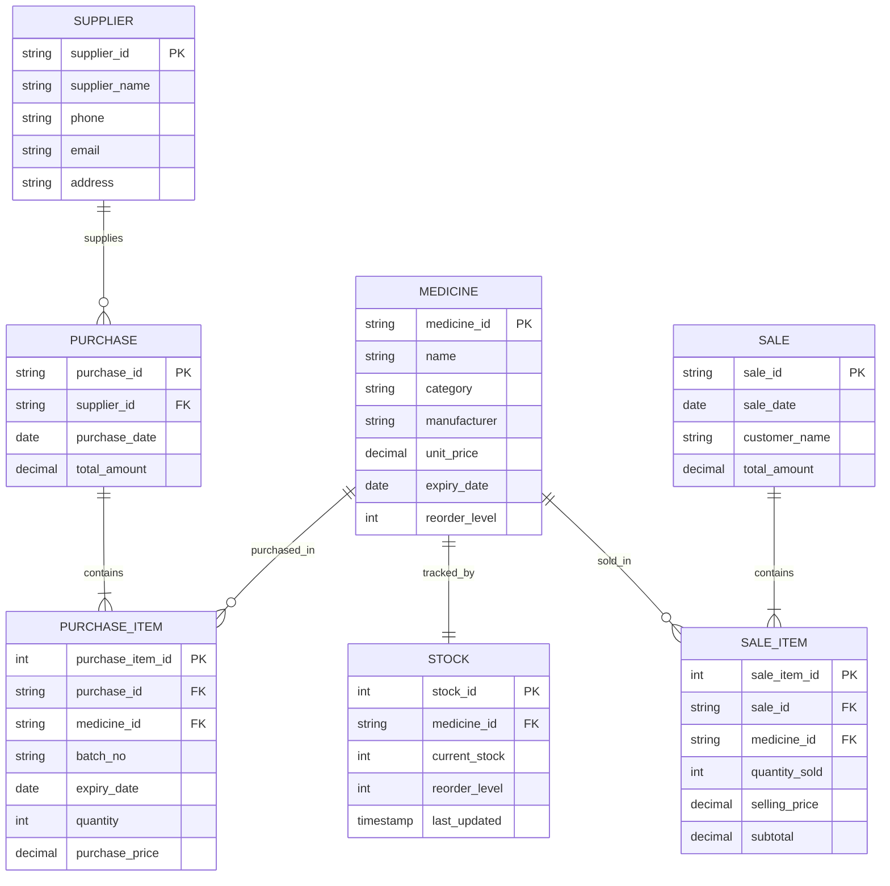

# Entity-Relationship (ER) Diagram & Relational Model Documentation
## Course: 25ITT31 - Database Management Systems (DBMS)
### Project: Pharmacy Stock Management and Medicine Sales Analysis System

---

## 1. Entity-Relationship Overview

The system architecture implements a centralized relational model that tracks the full pharmaceutical supply chain: procurement from suppliers, inventory tracking with reorder thresholds, batch management with expiry surveillance, and retail sales dispensation.

### Entities and Attributes

1. **SUPPLIER**
   - `supplier_id` (PK, String/Varchar)
   - `supplier_name` (String)
   - `phone` (String)
   - `email` (String)
   - `address` (String)

2. **MEDICINE**
   - `medicine_id` (PK, String/Varchar)
   - `name` (String)
   - `category` (String)
   - `manufacturer` (String)
   - `unit_price` (Decimal/Double)
   - `expiry_date` (Date)
   - `reorder_level` (Integer)

3. **STOCK**
   - `stock_id` (PK, Integer Auto-increment)
   - `medicine_id` (FK referencing MEDICINE, Unique)
   - `current_stock` (Integer, >= 0)
   - `reorder_level` (Integer)
   - `last_updated` (Timestamp)

4. **PURCHASE**
   - `purchase_id` (PK, String/Varchar)
   - `supplier_id` (FK referencing SUPPLIER)
   - `purchase_date` (Date)
   - `total_amount` (Decimal/Double)

5. **PURCHASE_ITEM**
   - `purchase_item_id` (PK, Integer Auto-increment)
   - `purchase_id` (FK referencing PURCHASE)
   - `medicine_id` (FK referencing MEDICINE)
   - `batch_no` (String)
   - `expiry_date` (Date)
   - `quantity` (Integer, > 0)
   - `purchase_price` (Decimal/Double)

6. **SALE**
   - `sale_id` (PK, String/Varchar)
   - `sale_date` (Date)
   - `customer_name` (String)
   - `total_amount` (Decimal/Double)

7. **SALE_ITEM**
   - `sale_item_id` (PK, Integer Auto-increment)
   - `sale_id` (FK referencing SALE)
   - `medicine_id` (FK referencing MEDICINE)
   - `quantity_sold` (Integer, > 0)
   - `selling_price` (Decimal/Double)
   - `subtotal` (Decimal/Double)

---

## 2. Mermaid ER Diagram

---

## 3. Relational Schema Mapping

- **SUPPLIER** (`supplier_id`, `supplier_name`, `phone`, `email`, `address`)
  - Primary Key: `supplier_id`

- **MEDICINE** (`medicine_id`, `name`, `category`, `manufacturer`, `unit_price`, `expiry_date`, `reorder_level`)
  - Primary Key: `medicine_id`

- **STOCK** (`stock_id`, `medicine_id`, `current_stock`, `reorder_level`, `last_updated`)
  - Primary Key: `stock_id`
  - Foreign Key: `medicine_id` references **MEDICINE**(`medicine_id`) ON DELETE CASCADE

- **PURCHASE** (`purchase_id`, `supplier_id`, `purchase_date`, `total_amount`)
  - Primary Key: `purchase_id`
  - Foreign Key: `supplier_id` references **SUPPLIER**(`supplier_id`) ON DELETE RESTRICT

- **PURCHASE_ITEM** (`purchase_item_id`, `purchase_id`, `medicine_id`, `batch_no`, `expiry_date`, `quantity`, `purchase_price`)
  - Primary Key: `purchase_item_id`
  - Foreign Key: `purchase_id` references **PURCHASE**(`purchase_id`) ON DELETE CASCADE
  - Foreign Key: `medicine_id` references **MEDICINE**(`medicine_id`) ON DELETE RESTRICT

- **SALE** (`sale_id`, `sale_date`, `customer_name`, `total_amount`)
  - Primary Key: `sale_id`

- **SALE_ITEM** (`sale_item_id`, `sale_id`, `medicine_id`, `quantity_sold`, `selling_price`, `subtotal`)
  - Primary Key: `sale_item_id`
  - Foreign Key: `sale_id` references **SALE**(`sale_id`) ON DELETE CASCADE
  - Foreign Key: `medicine_id` references **MEDICINE**(`medicine_id`) ON DELETE RESTRICT

---

## 4. Integrity Constraints & Business Rules
1. **Entity Integrity**: Every primary key (`supplier_id`, `medicine_id`, `purchase_id`, `sale_id`, `stock_id`) is non-null and unique.
2. **Referential Integrity**: Sales and purchases enforce foreign keys referencing valid master records.
3. **Domain Constraints**:
   - `unit_price > 0`, `purchase_price > 0`, `selling_price > 0`
   - `quantity > 0`, `quantity_sold > 0`, `current_stock >= 0`
4. **Transaction Atomicity**: Updating stock on sales and purchases runs in an atomic database transaction (`setAutoCommit(false)`), ensuring zero inconsistency even under failure conditions.
