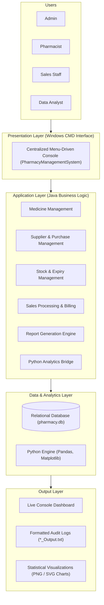
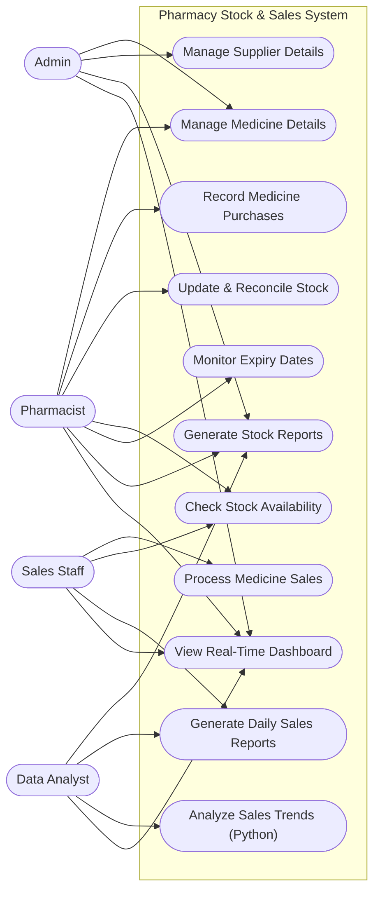
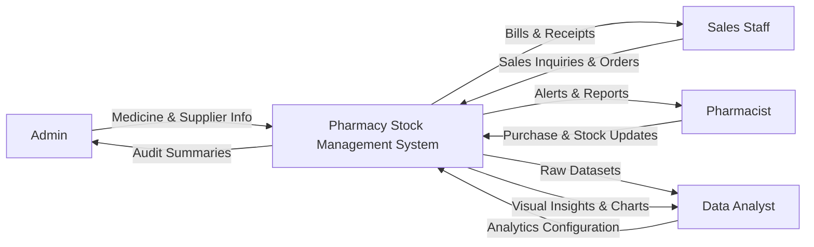
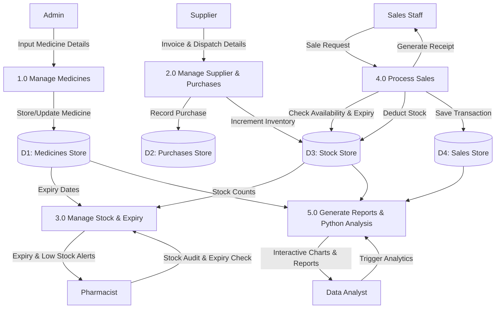
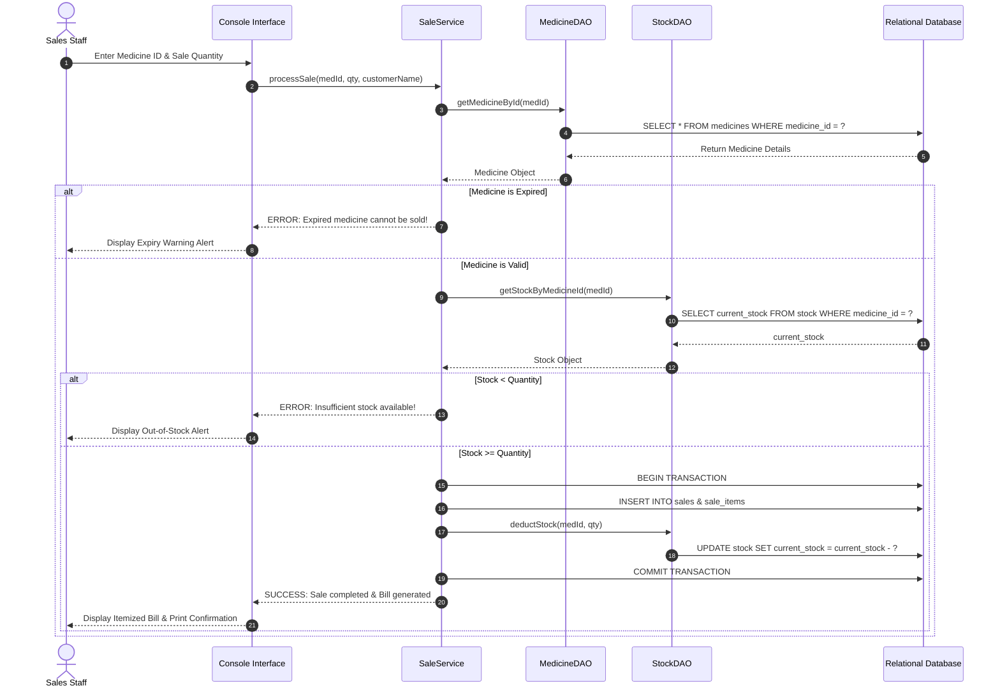
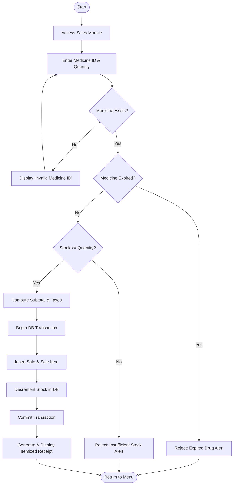

# System Architecture and Design Document
## Course: 25ITT33 - Software Engineering (SE)
### Project: Pharmacy Stock Management and Medicine Sales Analysis System

---

## 1. System Architecture Overview

The system employs a 4-Tier Architectural Pattern:
1. **User Role Layer**: Admin, Pharmacist, Sales Staff, Supplier, Data Analyst.
2. **Presentation Layer**: Windows CMD Interactive Console Interface with ASCII Table Formatting and ANSI-compliant styling.
3. **Application & Business Logic Layer**: Java DAO/Service Pattern managing business rules, transactions, and report formatting.
4. **Data & Analytics Layer**: Relational Database Engine (SQLite / PostgreSQL / MySQL) + Python Data Analytics Engine (Pandas & Matplotlib).

---

## 2. Use Case Diagram

---

## 3. Data Flow Diagram (DFD)

### 3.1 DFD Level 0 (Context Diagram)

### 3.2 DFD Level 1 (Decomposition)

---

## 4. Sequence Diagram: Sales Processing & Billing

---

## 5. Activity Diagram: Sale Workflow

